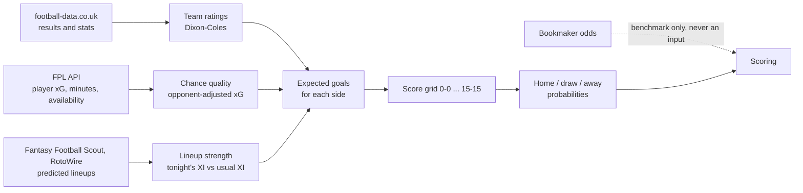

# TaBet: ML Model Edition

TaBet is a student software-engineering project (SWEF Fall 2026, TAMID at Northeastern) that
forecasts English Premier League matches. For every match it gives three probabilities, **home win /
draw / away win**, records them before kickoff, and scores them against what happened and against the
betting market.

**Live site:** https://ta-bet-ml-model-edition.vercel.app
- **Home page:** the model notebook. It explains every model and result in plain language and shows
  cards for the next gameweek's fixtures.
- **Match explorer** (`/matches`): pick any match since 2022-23 to see every TaBet forecast for it,
  the market's odds and the result.

> **Not a betting tool.** TaBet measures how far a transparent statistical model is from the market.
> It doesn't recommend bets, and so far it doesn't beat the market.

---

## Contents

1. [The idea in plain words](#1-the-idea-in-plain-words)
2. [How a forecast is made](#2-how-a-forecast-is-made)
3. [Results so far](#3-results-so-far)
4. [The live experiment (2026-27 season)](#4-the-live-experiment-2026-27-season)
5. [What runs automatically](#5-what-runs-automatically)
6. [Reading the website](#6-reading-the-website)
7. [What's in the repo](#7-whats-in-the-repo)
8. [Running it yourself](#8-running-it-yourself)
9. [House rules](#9-house-rules)
10. [Limitations](#10-limitations)
11. [FAQ](#11-faq)
12. [Glossary](#12-glossary)

---

## 1. The idea in plain words

- **Probabilities, not picks.** "Arsenal 55%, draw 25%, Chelsea 20%" says more than "Arsenal will
  win". It can also be judged fairly when the favourite loses, since a 20% outcome should happen
  about one time in five.
- **Scored with log-loss.** Each forecast is scored on the probability it gave to what actually
  happened: −ln(that probability). Lower is better.
  - Giving every outcome one-in-three scores **1.10**.
  - Football is mostly luck, so good models land around **0.95–1.00**.
  - The whole gap between our simplest model and the market is about 0.015, so a gain of 0.003 is
    real progress.
- **The betting market is the yardstick.** Bookmakers' prices, with their profit margin removed, are
  the strongest public forecast. They reflect injuries, team news and money from well-informed
  bettors. TaBet compares itself with them but **never uses odds as an input**, so it can't simply
  copy the market. It doesn't use crowd signals either (FPL ownership, transfers or prices).
- **No hindsight.** A forecast may use only what was known before its cutoff. A result counts as
  known 2.5 hours after kickoff. Models are trained on the past and scored on later matches.
- **Tests are written down before they run** (`docs/PREREGISTRATION.md`). Each test's design is
  committed before its results are seen, so a lucky result can't be presented as a planned one.

## 2. How a forecast is made



1. **Team ratings (V0).** Every team gets an attack and a defence rating, fitted to past scores with
   a Dixon-Coles model. Recent matches count more (a half-life of about 6 months), and the model
   corrects for how often low scores like 0-0 and 1-1 happen.
2. **Chance quality (V1x).** Scores are noisy, but chances are less so. The model adds each team's
   expected goals (xG) created and allowed, adjusted for how strong the opponents were, with about a
   3-month memory.
3. **Lineup strength (V2x).** Once a starting XI is known or predicted, the model compares tonight's
   starters with the team's usual starters. Each player is rated from his xG and assists per 90,
   shrunk towards his position's average.
4. **Probabilities.** These steps give each side an expected number of goals. The model turns them
   into the probability of every score from 0-0 to 15-15, then adds those up into home, draw and
   away.

**Worked example: Leeds v Tottenham, 7 November 2026.** The forecast was logged 25 hours before
kickoff:

| | Leeds | Draw | Tottenham |
|---|---|---|---|
| TaBet, no lineups (p0) | 44% | 30% | 26% |
| TaBet, predicted lineups (pE) | 43% | 29% | 28% |
| Betting market (pre-closing) | 35% | 28% | 37% |

Leeds won 1-0. TaBet's log-loss was −ln(0.44) = 0.82 and the market's was −ln(0.35) = 1.05, so TaBet
did better on this match. One match proves nothing, though: the comparison only means something
over hundreds of matches.

## 3. Results so far

All numbers are out-of-sample: each forecast was made with only earlier data.

**Models, 2024-25 and 2025-26 (760 matches):**

| Model | What it knows | Log-loss | Gap to closing odds |
|---|---|---|---|
| Closing odds (benchmark) | the market at kickoff | 0.9893 | 0 |
| Earlier odds (benchmark) | the market on the Friday or Tuesday before | 0.9929 | +0.0036 |
| **V2x**, with lineups | results, xG, confirmed starting XIs | 0.9973 | +0.0080 |
| **V1x**, before team news | results, opponent-adjusted xG | 1.0011 | +0.0118 |
| **V0**, results only | Dixon-Coles on scores | 1.0042 | +0.0150 |

- **xG helps every season:** V1x beats V0 by 0.003, in the same direction each time.
- **Lineups help in recent seasons but not in 2022-24.** A replication on 2018-21 found a small
  gain, concentrated in matches with unusual lineups.

**Head to head with the market (V2x, 2022-23 to 2025-26, 1,520 matches):**
- TaBet and the market pick the same favourite **88.5%** of the time against earlier odds (87.4%
  against closing odds).
- **When the picks differ, the market is right alone about 45% of the time and TaBet about 28%.**
  The rest are both wrong. Against closing odds that gap is very unlikely to be luck (p = 0.005).
- Most big disagreements come from the team ratings, not the lineup layer. They cluster around
  newly promoted teams early in the season.

**Ideas tested and dropped.** None beat the simpler model it extends on the same matches: a
calibration layer, similar-player ratings, team playing style, lineup changes by role, faster
league trends, predicting outcomes directly, lineups guessed from history, pooling four more
leagues, match statistics, promoted-team priors, new-signing ratings, weekly score-driven ratings,
shorter memory, an Elo blend, a Bayesian Dixon-Coles, bivariate Poisson and table stakes. The full
list, with every number, is in `docs/IMPROVEMENT_BRIEF.md`.

## 4. The live experiment (2026-27 season)

Backtests can fool you, so the main open question is being tested live, on matches that haven't
happened yet:

> **Do predicted lineups, published the day before a match, make the 24-hour forecast better?**

- **What's logged:** for every match, about 24–26 hours before kickoff (26–32 hours as a fallback),
  TaBet logs:
  - **p0**, without lineups
  - **pE**, using the lineups predicted by Fantasy Football Scout and RotoWire
  - a few other variants

  In the same run, a snapshot of the market's odds from The Odds API is saved, so each forecast is
  compared with the market at the same moment.

  Records are append-only and never edited.
- **Timeline:**

  | Gameweeks | What happens |
  |---|---|
  | 10 | First records. Only 1 of 10 matches was logged because GitHub's scheduler ran late, which was fixed with amendment A4 |
  | 11–19 | Fitting period: everything is logged and nothing is chosen. A blend weight α between p0 and pE is fitted once at the end, then frozen |
  | 20–29 | First, descriptive read |
  | 20–38 | Confirmatory read at the end of the season: does the blend beat p0? |

- **Rules:** `docs/PROSPECTIVE_PROTOCOL.md` holds the rules, a dated amendment for every change
  (all made before the records they affect), and an operations log of anything that went wrong.

## 5. What runs automatically

A GitHub Action (`.github/workflows/prospective.yml`) runs every 30 minutes. cron-job.org triggers it
(setup: `docs/LOGGER_SETUP.md`), and GitHub's own schedule runs every 2 hours as a backup. Each run:

1. **Logs any forecasts that are due** to `results/prospective/log.jsonl`. The raw lineup pages are
   kept next to it.
2. **Refreshes this season's results** from football-data.co.uk once a day, keeping the old file if
   the new one fails its checks.
3. **Archives pre-match odds**, for the market comparison only (`results/prospective/odds/`):
   - From football-data's `fixtures.csv`, at most hourly, saving a copy only when the file changes.
   - From **The Odds API**, once whenever a forecast is logged. This gives the market's prices at
     the same moment as TaBet's forecast, shown on the site as "Market at our forecast time". It
     uses the free plan, about 2 credits per call.
4. **Rebuilds the website's data** (`site/data/matches.json`) at least daily. Vercel redeploys the
   site from `main`.
5. **Writes a heartbeat** to the run summary: the next fixture, when its logging window opens, the
   results file's freshness and odds coverage.
6. **Raises alerts** by opening a GitHub issue titled "Prospective logger alert" when:
   - a match passes its window with no forecast
   - no run has succeeded for 3 hours while a window is open
   - the results file is behind for 2 days
   - a match within 24 hours has no odds snapshot

The bot commits to `main`, so **pull before you start work**.

## 6. Reading the website

| Label | Meaning |
|---|---|
| **Backtest** (V0, V1x, V2x) | Forecasts for past seasons, made with only earlier data but computed afterwards |
| **Logged** (p0, pE) | The forecast recorded before kickoff by the live logger: the real test |
| **Preview** | A lineup-free forecast for an upcoming match before its logged forecast exists. It changes as results come in |
| **Market at our forecast time** | The bookmaker average saved in the same run as TaBet's logged forecast, with the margin removed: the fair comparison |
| **Earlier odds** | The market on the Friday or Tuesday before the match, with the margin removed |
| **Closing odds** | The market at kickoff, with the margin removed |
| **Log-loss** (played matches) | How each forecast scored on that match; lower is better |

The site is plain HTML, CSS and JavaScript with no build step (`site/`). Only `site/data/matches.json`
is generated, by `python -m tabet site-data`.

## 7. What's in the repo

| Path | What it is |
|---|---|
| `tabet/` | the Python package (key modules below) |
| `res/` | football-data.co.uk season CSVs (results, match stats, odds): the raw input |
| `data/` | downloaded and processed data. `raw/` and `processed/` are not in git and are rebuilt on demand. `source_fixes.csv` blanks known bad source values |
| `results/` | experiment outputs. `results/prospective/` holds the live log, raw lineup pages, the odds archive and refresh logs |
| `prototypes/` | one script per experiment (`run_*.py`); each writes its numbers to `results/` |
| `site/` | the static website |
| `dashboard/` | an older standalone HTML forecast dashboard |
| `tests/` | the test suite |
| `docs/` | design notes, protocols and audits (below) |

**Key modules in `tabet/`:**
- `ingest.py`, `validate.py`, `store.py`: load and check the football-data CSVs, and answer "what was
  known before time T".
- `teams.py`: one ID per club and every spelling the sources use.
- `fpl.py`: the Fantasy Premier League archive and live API.
- `model.py`, `xg_strength.py`, `features.py`, `lineup.py`: Dixon-Coles ratings, adjusted xG and
  lineup strength.
- `forecast.py`: forecasts for upcoming fixtures.
- `lineup_sources.py`: reading the predicted-lineup pages.
- `prospective.py`: the live logger, its scoring, α fitting and the heartbeat.
- `odds_archive.py`, `market_benchmark.py`: the pre-match odds archive and the market comparison.
  These are benchmark only, and a test stops any model code from reading them.
- `site_data.py`: builds the website's data.
- `cli.py`: the `python -m tabet …` commands.

**Docs:**
- `docs/IMPROVEMENT_BRIEF.md`: **start here.** It covers every experiment and result, written for
  outside reviewers.
- `docs/SPEC.md`: the system design.
- `docs/PREREGISTRATION.md`: tests committed before they were run.
- `docs/PROSPECTIVE_PROTOCOL.md`: the live experiment's rules, amendments and operations log.
- `docs/LEAKAGE_AUDIT.md`: checks that no future information leaks into forecasts.
- `docs/SOURCE_AUDIT.md`: every data source tried, its terms, and why some aren't used.
- `docs/LOGGER_SETUP.md`: setting up the 30-minute trigger.

**Data sources:**
- football-data.co.uk: results, match stats and odds.
- The Fantasy Premier League API and its public archive: player minutes, xG and availability.
- Fantasy Football Scout and RotoWire: predicted lineups.

Sites behind bot protection (Cloudflare challenges and similar) aren't used.

## 8. Running it yourself

You need Python 3.12 or newer.

```
python3 -m venv .venv && source .venv/bin/activate
pip install -r requirements.txt
python -m pytest -q                      # run the tests
```

| Command | What it does |
|---|---|
| `python -m tabet validate` | load `res/*.csv` and run the data-quality checks |
| `python -m tabet build` | write `data/processed/{matches,odds}.csv` and a manifest |
| `python -m tabet history Arsenal --cutoff 2026-01-01T12:00Z --last 5` | a team's results known before a date |
| `python -m tabet forecast --gameweeks 4` | forecast upcoming fixtures into `results/forecasts/` |
| `python -m tabet log-forecasts --dry-run` | list the fixtures the logger would record now (writes nothing) |
| `python -m tabet score-forecasts` | score logged forecasts against confirmed lineups, results and the market |
| `python -m tabet heartbeat` | the logger's status: next fixture, misses, data freshness |
| `python -m tabet check-sources` | check each live data source is reachable and parses |
| `python -m tabet archive-odds --dir /tmp/odds` | fetch and archive football-data's odds once, into a folder of your choice |
| `python -m tabet site-data` | rebuild the website's data |
| `python dashboard/build.py out.html` | build the standalone dashboard from the latest forecast |

Experiments run as scripts, for example `python prototypes/run_market_comparison.py`.

`log-forecasts` without `--dry-run` writes real records, so leave that to the GitHub Action. To run
the Action by hand (the modes are log, dry-run, check-sources, score and warm):

```
gh workflow run prospective.yml -f mode=dry-run
```

## 9. House rules

- **Odds and crowd data are never model inputs.** A test enforces this.
- **Never edit or backfill** `results/prospective/log.jsonl` or `results/prospective/raw/`.
  Problems go in the protocol's operations log.
- **No rule changes after the first gameweek-11 record.** Changes before then are dated amendments.
- **New main tests are pre-registered**, by committing them before running them.
- **Bad source values are blanked, never guessed**, through `data/source_fixes.csv`.
- **Work goes on a branch with a pull request to `main`.** Pull first, because the bot commits there.

## 10. Limitations

- **The market is still better:** by 0.014–0.019 log-loss over 2022-26, and by 0.004–0.008 in
  2024-26.
- **Newly promoted teams** are the biggest weakness early in a season. Every fix tried so far has
  failed.
- **Small gains are hard to prove.** Detecting a gain of 0.003 needs well over 1,000 matches. That's
  why the live test runs all season and only a few hypotheses are tested.
- **No good per-player defensive rating.** Lineup strength is mostly attacking output.
- **Predicted lineups are applied with coefficients learned from confirmed lineups.** That assumes the
  predictions are close to the real XI, which is exactly what the live experiment checks.

## 11. FAQ

**Why not just use the odds as an input? They're better.**
Then TaBet would mostly copy the market, and we'd learn nothing about what the data alone can do.
The odds are kept as the target to beat.

**Why are the improvements so small?**
Most of a football result is luck. Even a perfect model would have a log-loss far above zero, and the
best public forecast (the market) is only about 0.015 better than a basic team-rating model.

**Why does the site sometimes say "the logger missed its window"?**
In gameweek 10, GitHub ran the scheduled logger only every 4–8 hours, so 9 of 10 matches got no
record. Those gaps are never backfilled. The external 30-minute trigger (amendment A4) fixed it
from gameweek 11.

**Is the data free to use?**
All sources are free. Their terms and what each one allows are in `docs/SOURCE_AUDIT.md`.

## 12. Glossary

- **Log-loss:** −ln(the probability given to what happened), averaged over matches. Lower is better.
- **xG (expected goals):** the chance that each shot is scored, judged from its type and position,
  summed over a match. It measures chance quality.
- **Dixon-Coles:** a classic football model in which each team has attack and defence ratings and
  goals follow a Poisson distribution, with a fix for low scores.
- **Pre-closing and closing odds:** the market a few days before the match, and at kickoff. Closing
  odds know more (late team news), so they're harder to beat.
- **Margin removal:** bookmakers' probabilities add up to more than 100%. Dividing each one by the
  total gives fair probabilities.
- **Gameweek:** one round of Premier League fixtures, as numbered by Fantasy Premier League.
- **FPL:** Fantasy Premier League, whose public API gives player minutes, xG and injury news.
- **Primary and fallback records:** the forecast logged 24–26 hours before kickoff, and a backup
  logged 26–32 hours before in case the primary is missed.
- **p0, pE, pα:** the live forecast without lineups, with predicted lineups, and a blend of the two
  with weight α.
- **Pre-registration:** committing a test's design to the repo before running it.
- **Backtest:** forecasting past matches with only the data available at the time.
